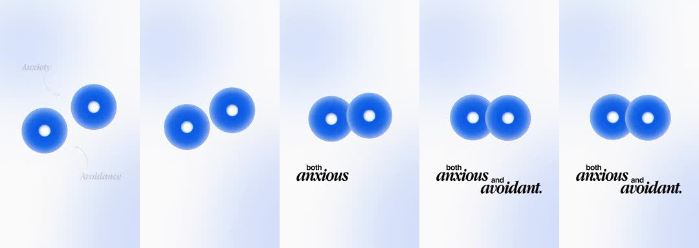

# v16_s10 · 07 Ilustración central + texto · 15.0–17.5s (calidad 5)

- **Guion:** Now, you can be the kind of person who's both anxious and avoidant.
- **Qué se ve:** Los discos se juntan y solapan en el centro; abajo-izquierda 'both' pequeño + 'anxious' serif itálica bold, 'and' + 'avoidant.'
- **Diseño:** Texto en escalera (dos líneas desplazadas), serif itálica bold negra ~2x; tercio inferior (~78 % altura).
- **Efectos:** Igual.
- **Animación:** Discos se deslizan uno hacia otro (≈0.5 s, ease in-out) hasta solaparse; texto aparece por palabra.
- **Por qué aquí:** 'Both' = solapamiento literal de los dos discos.
