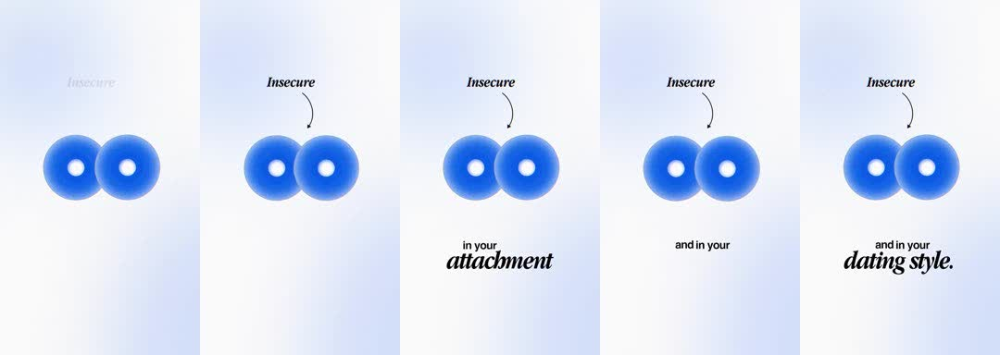

# v16_s11 · 07 Ilustración central + texto · 17.5–21.9s (calidad 5)

- **Guion:** That's called insecure in your attachment style and in your dating style. So
- **Qué se ve:** Discos solapados en el centro; arriba 'Insecure' serif itálica con flecha curva señalando la intersección; abajo 'in your' + 'attachment' + 'style' y luego 'and in your' + 'dating style.'
- **Diseño:** Etiqueta arriba (~35 % altura), texto abajo (~80 %); serif itálica bold negra grande + sans pequeña.
- **Efectos:** Igual.
- **Animación:** Flecha draw-on; texto inferior se reemplaza (fade out/in) al cambiar la frase.
- **Por qué aquí:** Define el término clave 'Insecure' sobre la zona de solapamiento: diagrama didáctico.
