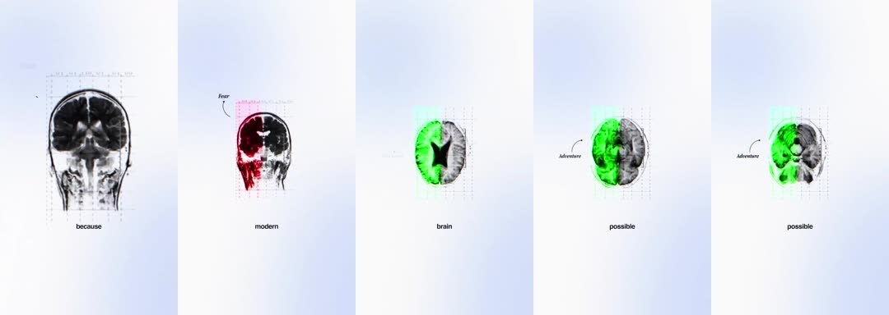

# v16_s17 · 07 Ilustración central + texto · 32.3–35.0s (calidad 5)

- **Guion:** you have a modern brain that makes it possible for
- **Qué se ve:** Fondo blanco-lavanda; resonancia de cerebro (vista axial) con zona resaltada en rojo y cuadrícula rosa + etiqueta 'Fear' con flecha; luego la misma imagen resaltada en verde con etiqueta 'Adventure'. Texto 'have a', 'brain', 'that makes it' abajo.
- **Diseño:** Imagen MRI B/N ~30 % ancho centrada; overlays rojo #E0203A y verde neón #39FF4F semitransparentes; cuadrícula fina; etiquetas serif itálica pequeña; caption sans negra pequeña abajo (~75 %).
- **Efectos:** Glow verde, overlay de color tipo escáner; cuadrícula técnica.
- **Animación:** Cambio de color rojo→verde con flash/glow (≈0.3 s); flechas draw-on.
- **Por qué aquí:** Visualiza el 'reencuadre': la misma área del cerebro pasa de miedo (rojo) a aventura (verde).
