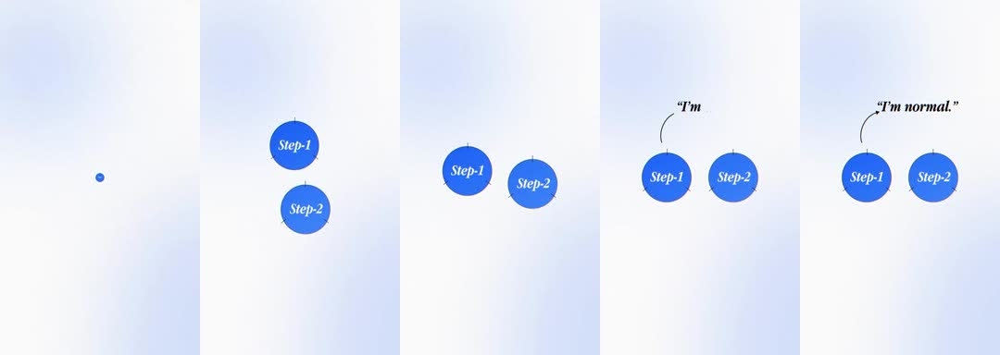

# v16_s19 · 07 Ilustración central + texto · 41.4–45.0s (calidad 5)

- **Guion:** step process. The first is to say this, I'm normal.
- **Qué se ve:** Fondo blanco-lavanda; dos círculos azules sólidos con 'Step-1' y 'Step-2' en serif itálica blanca, primero en diagonal y luego alineados horizontalmente; arriba '“I'm n...' con flecha curva desde Step-1.
- **Diseño:** Círculos azul #1E5BFF ~22 % ancho con pequeño tick en el borde; serif itálica blanca dentro; cita serif itálica negra arriba con comillas.
- **Efectos:** Sombra/glow muy sutil.
- **Animación:** Círculos pop en stagger, luego se alinean (slide ≈0.4 s); flecha draw-on; cita write-on letra a letra.
- **Por qué aquí:** Proceso de 2 pasos = dos objetos numerados. Estructura clara y memorable.
