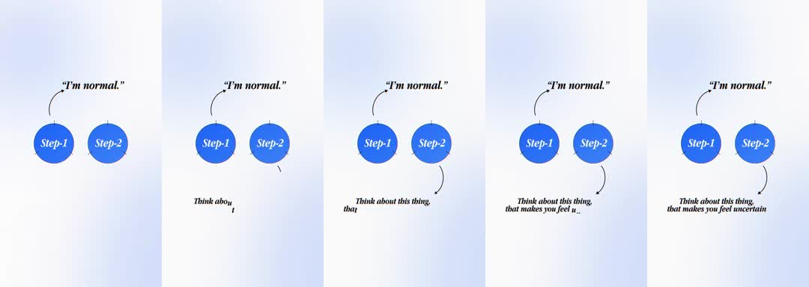

# v16_s26 · 07 Ilustración central + texto · 66.5–68.9s (calidad 5)

- **Guion:** Think about this thing that makes you feel uncertain.
- **Qué se ve:** Vuelve el diagrama Step-1/Step-2 alineados con '“I'm normal.”' arriba y ahora flecha desde Step-2 hacia abajo con 'Think about this thing, that makes you feel...' en serif itálica escribiéndose.
- **Diseño:** Igual sistema que s19; texto inferior serif itálica negra pequeña en 2 líneas (~75 % altura).
- **Efectos:** Igual.
- **Animación:** Flecha draw-on hacia abajo; write-on letra a letra (efecto máquina de escribir).
- **Por qué aquí:** Callback del diagrama: el espectador ve progresar el proceso (paso 1 completado → paso 2).
