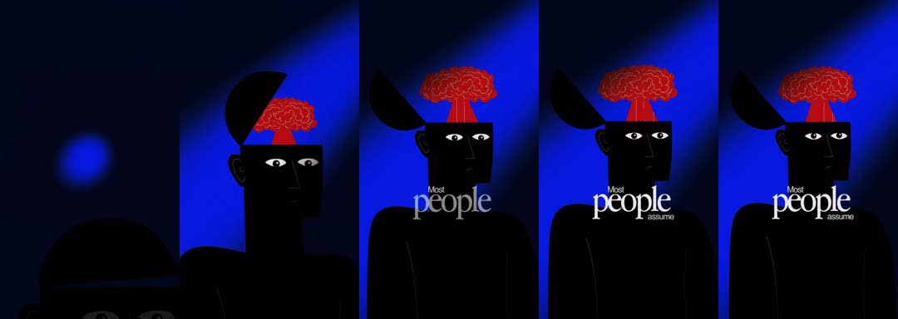

# v19_s01 · 07 Ilustración central + texto · 0.0–1.4s (calidad 5)

- **Guion:** Most people
- **Qué se ve:** Ilustración plana de una cabeza-silueta negra con la tapa del cráneo abierta (bisagra) y un cerebro rojo saliendo; ojos blancos simples. Fondo negro con haz de luz azul eléctrico diagonal desde arriba-izquierda. Caption 'Most' pequeño + 'people' grande debajo, en el tercio medio-bajo sobre el pecho de la figura.
- **Diseño:** Caption serif condensada de contraste alto (tipo Playfair/Didone), blanco #FFFFFF, palabra principal ~2.5x la secundaria, palabra pequeña 'Most' sans/serif fina encima-izquierda. Paleta: negro #090B1A, azul #0120E4, rojo cerebro ~#C0201A. Composición centrada, figura ocupa mitad inferior.
- **Efectos:** Haz de luz azul con falloff suave (gradiente), sin grano visible; contraste duro.
- **Animación:** Entra ya en marcha (hook sin fade): la tapa del cráneo se abre y el cerebro 'salta'; texto aparece palabra a palabra con pop + leve blur (≈0.2 s). Sensación seca, inmediata.
- **Por qué aquí:** Hook visual: imagen absurda y metafórica ('abrir la cabeza') que detiene el scroll antes de que se entienda la tesis. Anuncia que vamos a revisar una creencia de la mente.
