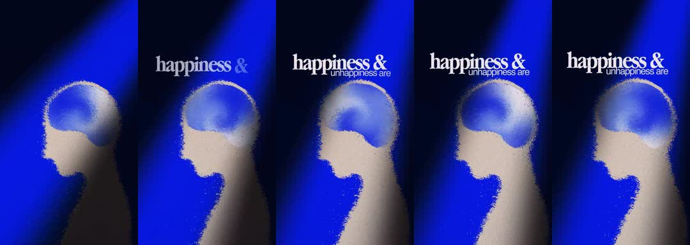

# v19_s02 · 07 Ilustración central + texto · 1.4–2.9s (calidad 5)

- **Guion:** assume that happiness and unhappiness are
- **Qué se ve:** Cabeza de perfil en textura dither/pixel (beige) con el cerebro azul, sobre fondo azul degradado a negro. Arriba: 'happiness &' grande y 'unhappiness are' pequeño debajo, alineados a la derecha.
- **Diseño:** Serif Didone condensada blanca, 'happiness &' ~3x 'unhappiness are' (sans o serif fina). Bloque de texto en tercio superior (~25 % altura). Azul #0120E4 → negro #040C2E.
- **Efectos:** Dithering/halftone de píxel grueso en la silueta (look de impresión digital), bordes erosionados; leve brillo azul.
- **Animación:** Transición de la ilustración anterior a esta por morph/dissolve dither (≈0.3 s); el texto pequeño se escribe palabra a palabra mientras la grande queda fija.
- **Por qué aquí:** Presenta los dos términos del tema (felicidad e infelicidad) dentro de 'la cabeza': el texto grande nombra el concepto clave, el pequeño es relleno del habla.
