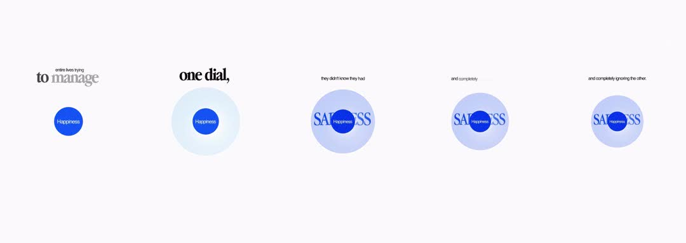

# v19_s18 · 07 Ilustración central + texto · 28.1–33.0s (calidad 5)

- **Guion:** to manage one dial. They didn't know they had and completely ignoring the other.
- **Qué se ve:** Fondo blanco; 'one dial,' en serif negra con 'dial' gris; debajo un dial circular: anillo azul claro con punto azul central 'Happiness'. Luego aparece detrás, enorme y parcialmente oculto, 'SADNESS' en serif azul claro; textos diminutos arriba 'they didn't know they had' / 'and completely ignoring the other'.
- **Diseño:** Círculo concéntrico: halo #C6D3F7, núcleo azul #0A57F8 con etiqueta sans blanca. 'SADNESS' serif Didone mayúscula ~90 % del ancho, color azul lavado detrás del círculo. Todo centrado en el eje vertical medio.
- **Efectos:** Glow/difuminado suave del halo; sin grano.
- **Animación:** Dial aparece con scale-in (≈0.4 s); 'SADNESS' se revela detrás con fade-in lento (≈0.6 s) mientras el círculo lo tapa; textos pequeños write-on.
- **Por qué aquí:** El clímax de la tesis: el 'otro dial' que ignoras está literalmente oculto detrás del que miras. Metáfora visual perfecta del guion.
