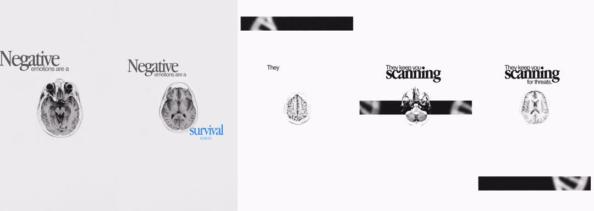

# v19_s21 · 07 Ilustración central + texto · 36.8–39.8s (calidad 4)

- **Guion:** system. They keep you scanning for threats.
- **Qué se ve:** Fondo blanco con barras negras horizontales arriba y abajo (franjas con imagen borrosa, como banda de película); un cerebro en corte axial dibujado a lápiz en el centro; 'They' y luego 'They keep you' + 'scanning' grande + 'for threats.'
- **Diseño:** 'scanning' serif Didone negra grande, resto sans diminuta. Cerebro grabado/lápiz gris ~25 % ancho, centrado bajo el texto.
- **Efectos:** Estética de grabado/lápiz; barras negras tipo letterbox parcial.
- **Animación:** Barras entran/salen deslizando horizontalmente (≈0.3 s); cerebro fade-in; texto por palabra.
- **Por qué aquí:** 'Scanning' se refuerza con las barras que barren la pantalla (como un escáner). Momento explicativo → ilustración.
