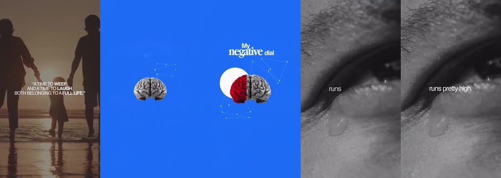

# v19_s29 · 07 Ilustración central + texto · 51.8–54.4s (calidad 5)

- **Guion:** My negative dial runs pretty hot.
- **Qué se ve:** Fondo azul; 'My' + 'negative' (serif, contorno/azul claro) + 'dial'; cerebro 3D partido: mitad roja (anatómica) y mitad gris, delante de un semicírculo blanco; red de puntos y líneas finas blancas tipo constelación alrededor.
- **Diseño:** Serif Didone blanca, 'negative' en tono lavado; cerebro ~45 % ancho centrado; azul #1369F7.
- **Efectos:** Cerebro fotográfico recortado, líneas 1 px con nodos.
- **Animación:** La constelación se dibuja con líneas que conectan nodos (≈0.5 s); cerebro pop + leve rotación.
- **Por qué aquí:** Giro a lo personal ('My'): el cerebro rojo = caliente/negativo. Visualiza 'runs hot' sin decir más.
