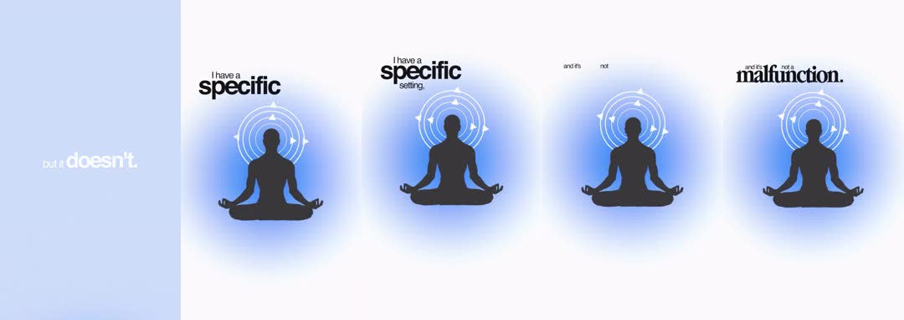

# v19_s33 · 07 Ilustración central + texto · 58.7–61.3s (calidad 5)

- **Guion:** It means I have a specific setting and it's not a malfunction.
- **Qué se ve:** Fondo blanco con glow radial azul; silueta negra de persona meditando; anillos concéntricos blancos con flechas girando alrededor de la cabeza; 'I have a' + 'specific' + 'setting.' y luego 'and it's not' / 'a malfunction'.
- **Diseño:** Silueta negra ~55 % ancho, centrada en mitad inferior; serif Didone negra para palabra clave en tercio superior; glow #3A7AF9 suave.
- **Efectos:** Glow/bloom azul radial, sin grano.
- **Animación:** Anillos rotan continuamente (loop ≈2 s/vuelta); glow pulsa; texto pop por palabra.
- **Por qué aquí:** 'Setting' = ajuste interno: los anillos rotatorios son un dial alrededor de la mente. Calma visual tras el momento vulnerable.
