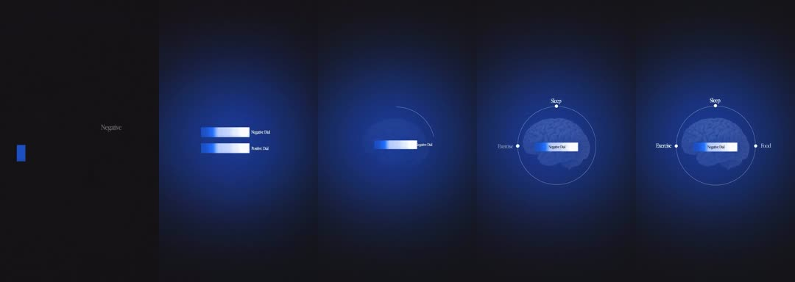

# v19_s37 · 07 Ilustración central + texto · 68.3–71.9s (calidad 4)

- **Guion:** I started managing the negative dial through sleep, exercise, and food.
- **Qué se ve:** Fondo azul marino oscuro con gradiente; dos barras horizontales tipo slider con degradado blanco→azul 'Negative Dial' / 'Positive Dial'; luego un cerebro azul translúcido dentro de un círculo fino con etiquetas orbitando: 'Sleep', 'Exercise' (y comida) con puntos.
- **Diseño:** Barras ~35 % ancho centradas; círculo línea 1 px; etiquetas sans diminuta blanca. Navy #13192D.
- **Efectos:** Glow suave del cerebro; sin grano.
- **Animación:** Barras se rellenan; zoom a círculo; etiquetas aparecen en órbita una por palabra dicha.
- **Por qué aquí:** Lista práctica (sueño, ejercicio, comida) → elementos orbitando el cerebro: cada palabra tiene su ancla visual.
