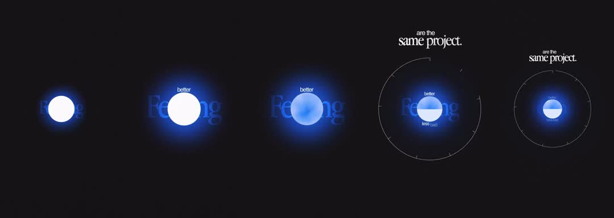

# v19_s43 · 07 Ilustración central + texto · 81.3–83.8s (calidad 5)

- **Guion:** feeling better and feeling less bad are the same project.
- **Qué se ve:** Fondo casi negro; un orbe blanco con glow azul y la etiqueta 'better'; detrás, muy grande y borroso, 'Feeling' en serif azul oscuro. Luego el orbe se llena a medias de azul ('less bad') dentro de un anillo de dial fino con marcas; 'are the' + 'same project.' arriba.
- **Diseño:** Orbe ~25 % ancho centro; anillo 1 px gris ~70 % ancho; serif Didone blanca arriba. Negro #131115.
- **Efectos:** Bloom/glow azul intenso, blur gaussiano en la palabra de fondo.
- **Animación:** Orbe aparece con glow que crece; relleno líquido sube (≈0.5 s); anillo se dibuja alrededor.
- **Por qué aquí:** Visualiza la confusión de los dos proyectos: el mismo orbe mostrando 'mejor' vs 'menos mal'.
