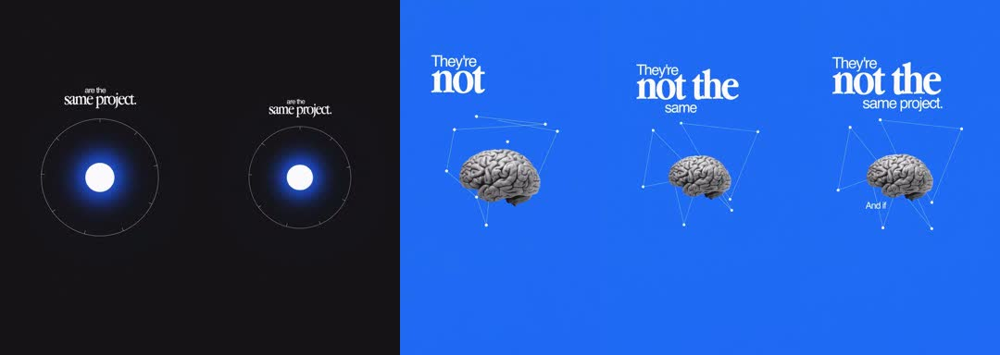

# v19_s44 · 07 Ilustración central + texto · 83.8–86.2s (calidad 3)

- **Guion:** They're not the same project. And if you
- **Qué se ve:** Fondo azul; 'They're' arriba-izquierda; constelación de nodos blancos conectados por líneas finas y tres círculos (blanco, azul, blanco) en fila; texto fantasma 'same project'.
- **Diseño:** Nodos blancos 1–2 px; círculos ~6 % ancho; sans blanca.
- **Efectos:** Plano.
- **Animación:** Líneas se dibujan entre nodos; los círculos se separan (≈0.4 s).
- **Por qué aquí:** Separar los círculos = 'no son el mismo proyecto'.
