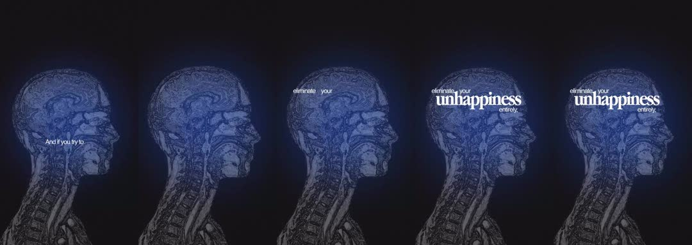

# v19_s45 · 07 Ilustración central + texto · 86.2–89.3s (calidad 5)

- **Guion:** try to eliminate your unhappiness entirely, you will eliminate
- **Qué se ve:** Fondo negro; cabeza de perfil tipo resonancia/rayos X en azul con glow; 'And if you try' pequeño, luego 'eliminate your' + 'unhappiness' serif grande + 'entirely.'; al final se lava a gris (desaparece).
- **Diseño:** Imagen anatómica azul #2A3350 a ~80 % alto, perfil a la derecha; serif Didone blanca centro.
- **Efectos:** Glow azul, textura de escáner; desaturación a gris en la salida (fade-to-grey = 'eliminar').
- **Animación:** Zoom lento hacia la cabeza; texto por palabra; salida con bleach/fade.
- **Por qué aquí:** 'Eliminate' se escenifica borrando la imagen: el efecto visual ejecuta lo que dice la frase.
