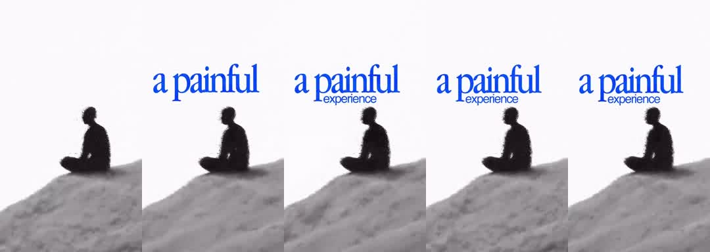

# v10_s02 · 08 Ilustración lateral + texto · 1.6–2.9s (calidad 4)

- **Guion:** after a painful experience
- **Qué se ve:** Fondo blanco roto; colina de arena/roca gris granulada en diagonal desde abajo; silueta negra sentada (rodillas recogidas) a la derecha sobre la cima. Texto 'a painful' grande y 'experience' pequeño en el tercio superior.
- **Diseño:** 'a painful' serif condensada azul (#1E50E6 aprox.), 'a' más pequeña que 'painful'; 'experience' sans regular pequeña azul debajo, a la derecha. Texto centrado-arriba; figura en el lado derecho-centro. Paleta: blanco #F9F7FA, grises #918D90/#797478, negro #1B1519, acento azul.
- **Efectos:** Grano fotográfico fuerte, figura con bordes dispersos (efecto polvo/partículas), estética de ilustración-foto tratada. Ligera textura de papel.
- **Animación:** Entra con la figura ya en escena (corte seco desde el slide); el texto aparece 1 frame después con pop+fade (~0.2 s). Leve push-in lento sobre la figura.
- **Por qué aquí:** Describe el dolor: figura sola, sentada, aislada = soledad tras el dolor. El azul en el texto mantiene la marca aunque el fondo cambie a blanco.
