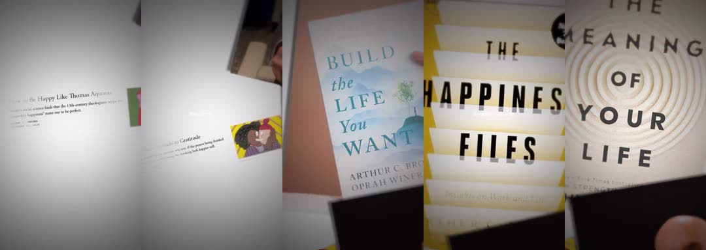

# v01_s62 · 09 Objetos - elementos + texto · 137.8–140.4s (calidad 5)

- **Guion:** the column that I write, the books that I write, the
- **Qué se ve:** Macro de sus obras: página de columna 'The Atlantic' ('Attitude to Gratitude'), libros 'From Strength to Strength', 'The Happiness Files', 'The Meaning of Your Life' esparcidos.
- **Diseño:** Libros en ángulo ocupando todo el cuadro; caption sans pequeña blanca 'the column that I' centrada.
- **Efectos:** Poca profundidad de campo, viñeta, luz lateral suave.
- **Animación:** Movimiento de cámara macro deslizante (slide/rotación lenta) con cortes cada ≈0.5–1 s.
- **Por qué aquí:** Producto y prueba: muestra literalmente lo que enumera.
