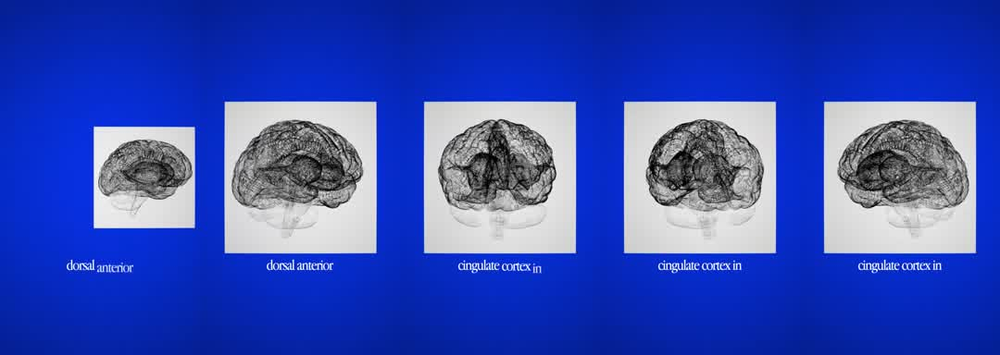

# v08_s11 · 09 Objetos - elementos + texto · 17.6–19.2s (calidad 5)

- **Guion:** dorsal anterior cingulate cortex in
- **Qué se ve:** Fondo azul degradado; tarjeta cuadrada blanca con un cerebro dibujado en malla/wireframe negro (líneas densas) que rota en 3D; texto del término anatómico debajo.
- **Diseño:** 'dorsal anterior' / 'cingulate cortex in' serif pequeña blanca centrada bajo la tarjeta. Tarjeta ~55% ancho, centrada a media altura.
- **Efectos:** Degradado azul más oscuro en los bordes (viñeta azul).
- **Animación:** La tarjeta entra deslizándose desde la derecha (pequeña) y escala al centro (~0.3 s); el cerebro rota lentamente.
- **Por qué aquí:** Término técnico difícil → objeto visual de 'lámina científica' para dar credibilidad sin explicar.
