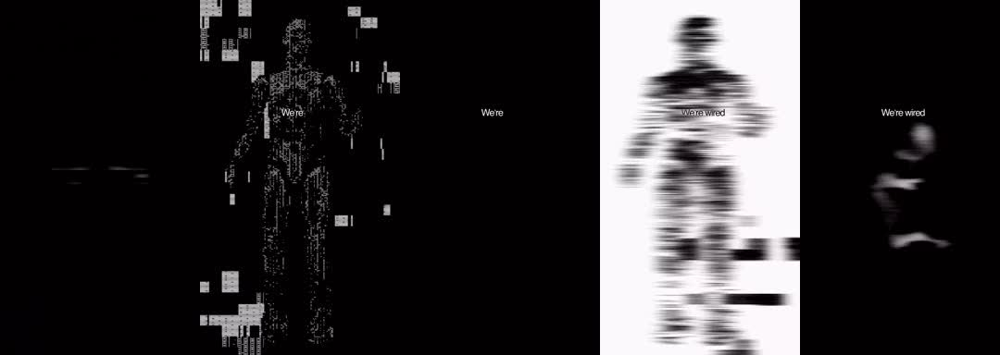

# v10_s17 · 09 Objetos - elementos + texto · 27.3–28.0s (calidad 5)

- **Guion:** We're wired
- **Qué se ve:** Secuencia glitch: figura humana de cuerpo entero pixel-sorted/arrastrada en horizontal sobre blanco; alterna con fondo negro donde la misma figura es una malla de caracteres/puntos tipo ASCII/datamosh con bloques de interfaz; luego figura borrosa, después un feto blanco desenfocado sobre negro y finalmente ilustración B/N de un embrión dentro de un cuadrado redondeado.
- **Diseño:** 'We're' / 'We're wired' sans pequeña blanca centrada en el tercio superior. Blanco/negro puros.
- **Efectos:** Pixel sorting, datamosh, ASCII/dot-matrix, bloques de glitch digital, blur, inversión.
- **Animación:** Cortes de 2–4 frames entre estados (glitch), ~0.7 s total. Muy seco y rápido.
- **Por qué aquí:** 'Estamos programados/cableados': el glitch y el ASCII = programación, código; el embrión = desde el nacimiento. Transición de energía alta antes del concepto biológico.
