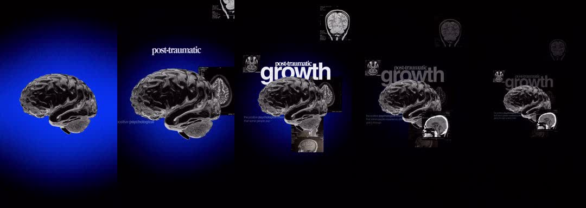

# v10_s30 · 09 Objetos - elementos + texto · 49.7–51.0s (calidad 5)

- **Guion:** Researchers who study post-traumatic growth
- **Qué se ve:** Fondo negro con glow radial azul; cerebro 3D cromado/metálico; collage de miniaturas de resonancias magnéticas (MRI) alrededor; 'post-traumatic' y 'growth' grandes en gris; párrafo diminuto de definición ('the positive psychological change that some people experience after going through a deep crisis').
- **Diseño:** 'growth' sans bold gris claro grande, 'post-traumatic' serif más pequeña encima; párrafo sans diminuto alineado a la izquierda con palabra en negrita. Miniaturas cuadradas B/N dispersas. Azul glow #0B3FF5 → negro.
- **Efectos:** Render cromado con reflejos, glow azul, collage tipo moodboard científico.
- **Animación:** Arranca con un plano cerrado del cerebro sobre el glow azul y hace zoom-out rápido (~0.5 s) revelando el collage y el título; las miniaturas aparecen con pop escalonado.
- **Por qué aquí:** Introduce un término técnico: se define en pantalla (micro-texto) y se apoya en iconografía científica para dar credibilidad.
