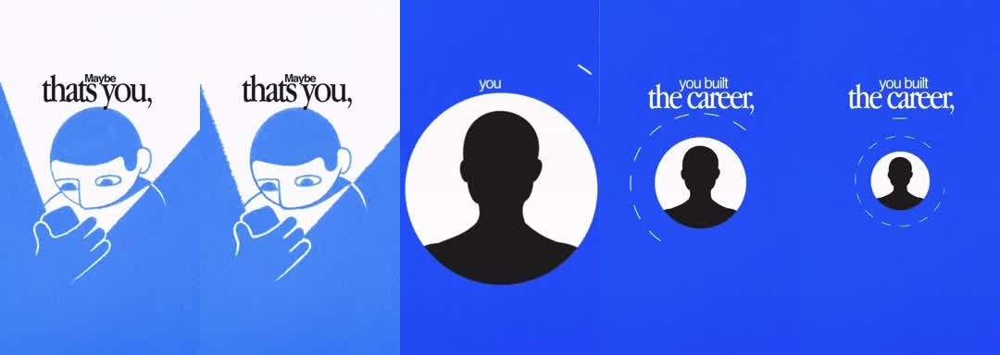

# v12_s09 · 09 Objetos - elementos + texto · 9.4–10.6s (calidad 5)

- **Guion:** You built the career.
- **Qué se ve:** Avatar genérico (silueta negra en círculo blanco) que llega desenfocado y gigante y se aleja hasta tamaño medio sobre fondo azul; encima 'you'. Luego 'you built / the career,' y aparecen anillos discontinuos.
- **Diseño:** Fondo azul #184EF9 con textura; círculo blanco #FBF9F9 con silueta #1A1819 centrado a ~50 %. Texto 'you' sans regular blanca pequeña; 'the career,' serif condensada blanca grande, centrado ~22 %.
- **Efectos:** Blur de movimiento en la entrada, textura de papel, pequeño trazo blanco tipo 'chispa'.
- **Animación:** Zoom-out rápido con blur-to-sharp (~0.3 s), luego el avatar se encoge al centro mientras nacen anillos orbitales discontinuos. Elástico/suave.
- **Por qué aquí:** Convierte 'tú' en un perfil-avatar al que se le van añadiendo logros: metáfora de 'perfil/currículum vital'.
