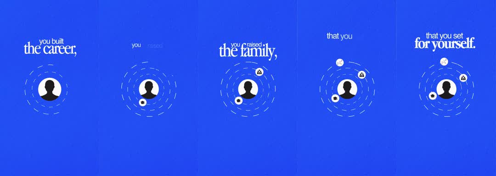

# v12_s10 · 09 Objetos - elementos + texto · 10.6–14.1s (calidad 5)

- **Guion:** You raised the family. You hit many of the goals that you set for yourself.
- **Qué se ve:** Avatar central pequeño con 3 anillos discontinuos concéntricos que giran; iconos en círculos blancos orbitando (birrete de graduación, familia, gráfico/objetivo). Texto cambia: 'you raised / the family,' → 'you hit many' → 'that you set / for yourself.'.
- **Diseño:** Igual que s09: fondo azul #1950F7, iconos negros en círculos blancos ~8 % del ancho, órbitas blancas discontinuas finas. Texto serif condensada grande + sans pequeña blanca a ~20–25 % de altura; 'for yourself.' en sans bold.
- **Efectos:** Grano/textura papel.
- **Animación:** Los anillos rotan lentamente y a cada logro nombrado aparece un icono nuevo con pop (escala 0→1, ~0.2 s, ease-back). Texto ghost→blanco por palabra.
- **Por qué aquí:** Lista acumulativa de logros = animación que 'suma' objetos alrededor de la persona; visualiza la vida 'completa' antes del giro.
