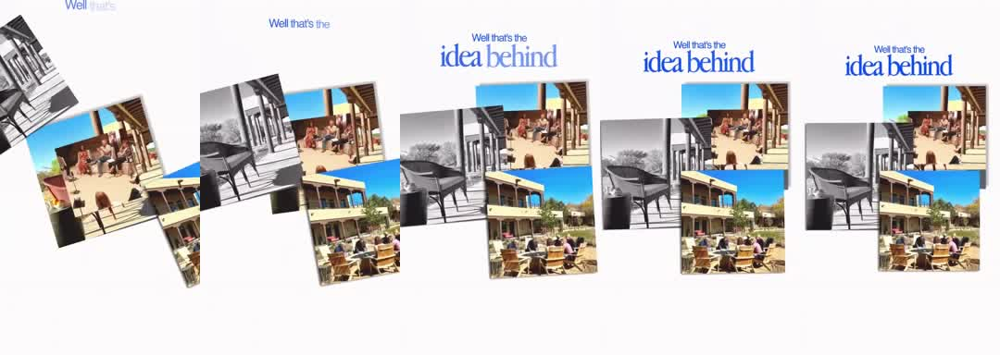

# v12_s34 · 09 Objetos - elementos + texto · 61.3–62.9s (calidad 5)

- **Guion:** Well, that's the idea behind
- **Qué se ve:** Collage de 3 fotos del retiro (porche b/n con sillón de mimbre, grupo charlando en terraza, patio con sillas de madera y personas) superpuestas con ligeras rotaciones sobre blanco; encima 'Well that's the / idea behind'.
- **Diseño:** Fotos rectangulares con borde fino blanco y sombra paralela, ocupando ~70 % del ancho a ~40–75 % de altura; texto 'Well that's the' sans azul pequeña + 'idea behind' serif condensada azul grande arriba ~15 %.
- **Efectos:** Sombra paralela suave, una foto en b/n para contraste.
- **Animación:** Fotos caen/se apilan una a una (slide + rotate + settle ~0.3 s cada una); texto karaoke.
- **Por qué aquí:** Introducción del producto: fotos reales tipo álbum = autenticidad y prueba social.
