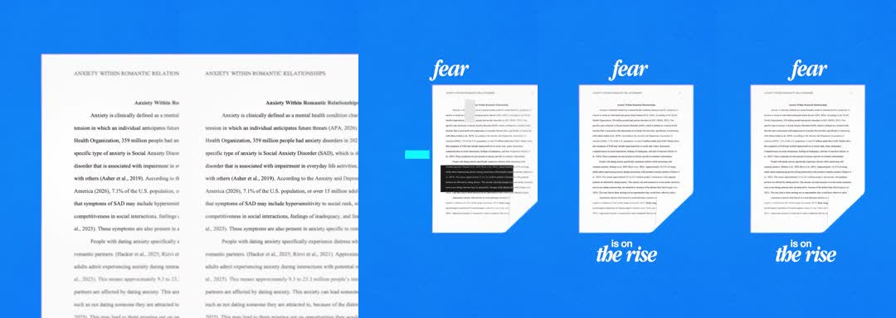

# v16_s06 · 09 Objetos - elementos + texto · 6.1–8.4s (calidad 5)

- **Guion:** clear that fear is on the rise from
- **Qué se ve:** Fondo azul; 'fear' serif itálica blanca arriba, hoja del paper en el centro, 'is on' pequeño + 'the rise' serif itálica bold abajo.
- **Diseño:** Layout sándwich: título arriba (~20 % altura), objeto centro, frase abajo (~78 %). Serif itálica blanca. Azul #0279F8.
- **Efectos:** Plano, sombra mínima.
- **Animación:** Zoom-out del documento a tarjeta; 'fear' blur-in; 'the rise' entra al final (write-on).
- **Por qué aquí:** Dato clave (el miedo sube) con palabra emocional 'fear' destacada sobre la evidencia.
