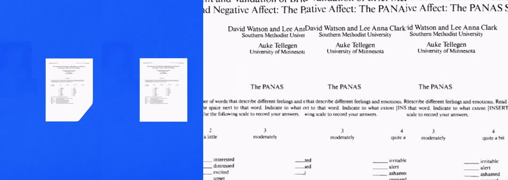

# v19_s12 · 09 Objetos - elementos + texto · 15.4–16.5s (calidad 4)

- **Guion:** PANAS, the Positive
- **Qué se ve:** Sobre azul, una hoja de paper académico (PANAS) entra con la esquina doblada; zoom rápido a pantalla completa del texto del paper (título 'The PANAS', autores Watson, Clark, Tellegen).
- **Diseño:** Hoja blanca centrada (~45 % ancho) con sombra mínima; fondo azul #0E5BFA. El zoom-in muestra la tipografía serif del documento real.
- **Efectos:** Sombra muy suave; ningún grano.
- **Animación:** Page-curl de la esquina + slide-in (≈0.3 s); punch-in de cámara al documento (≈0.4 s) y vuelta.
- **Por qué aquí:** Prueba documental: enseñar el paper real convierte la afirmación en evidencia. El zoom da sensación de 'investigación'.
