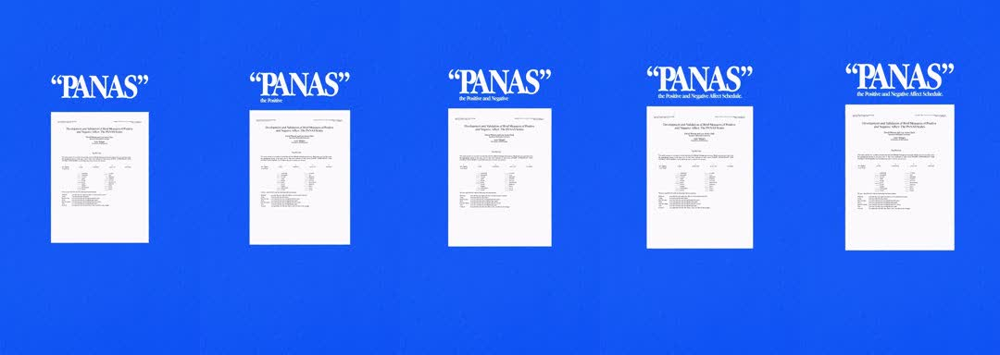

# v19_s13 · 09 Objetos - elementos + texto · 16.5–19.1s (calidad 5)

- **Guion:** and Negative Affect Schedule.
- **Qué se ve:** Fondo azul; título '“PANAS”' entre comillas tipográficas en serif bold blanca grande arriba, subtítulo 'the Positive and Negative Affect Schedule' diminuto; la hoja del paper centrada debajo.
- **Diseño:** Serif Didone bold condensada blanca, comillas curvas grandes; tercio superior (~30 %); subtítulo sans ~2 % altura escrito palabra a palabra. Azul #0957F9.
- **Efectos:** Plano; hoja con sombra suave.
- **Animación:** Título pop + blur-in (≈0.25 s); subtítulo write-on por palabra; la hoja sube ligeramente (drift lento).
- **Por qué aquí:** Nombre propio de la herramienta = palabra a recordar (vuelve en el CTA). Se le da jerarquía de titular.
