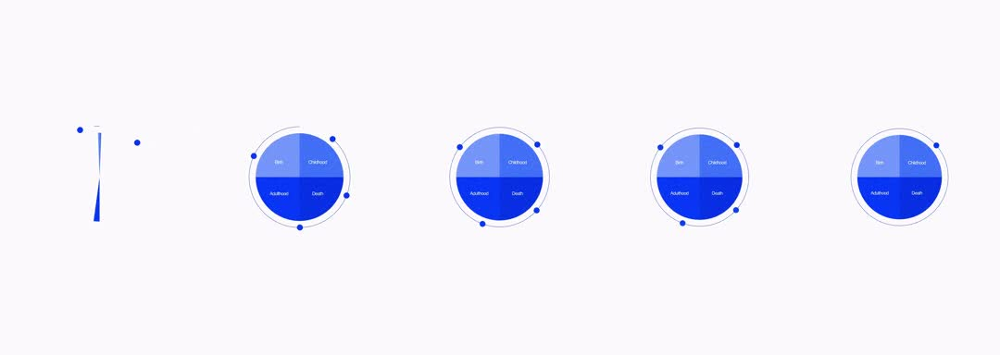

# v10_s26 · 10 Gráficas y estadística · 40.4–43.0s (calidad 4)

- **Guion:** rush past the lesson, you lose what it was trying to show you.
- **Qué se ve:** Fondo blanco; gráfico circular (pie) dividido en 4 cuadrantes en tonos de azul con etiquetas diminutas 'Birth', 'Childhood', 'Adulthood', 'Death'; anillo exterior fino con puntos azules que orbitan. Sin subtítulo de la frase.
- **Diseño:** Cuadrantes en azules de claro a oscuro (#7DA0F5 → #0B3FF5), etiquetas sans blanca diminuta dentro de cada cuadrante; anillo exterior 1 px azul con 3–4 puntos sólidos. Centrado, ~35% del ancho.
- **Efectos:** Plano, flat design sin textura.
- **Animación:** Los cuadrantes entran como cuñas que giran y se ensamblan (dos cuñas opuestas primero, luego el círculo completo) ~0.6 s; los puntos del anillo orbitan continuamente; ligero zoom-out.
- **Por qué aquí:** La 'lección' se visualiza como el ciclo completo de la vida: saltarse una etapa es perder parte del círculo. Momento de valor abstracto → animación.
