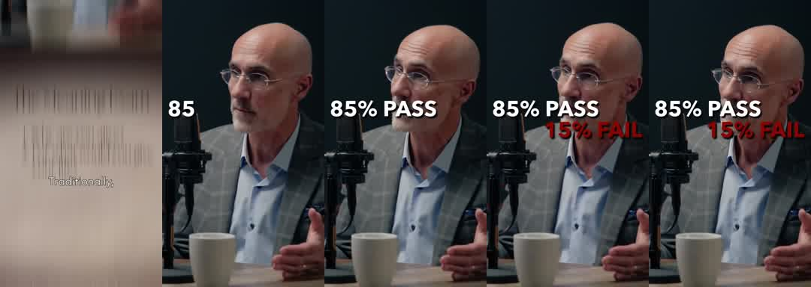

# v11_s20 · 10 Gráficas y estadística · 33.8–37.9s (calidad 4)

- **Guion:** Traditionally, about 85 % of my students passed and 15 % failed.
- **Qué se ve:** Brooks plano medio gesticulando; a la izquierda-centro aparece '85% PASS' y debajo, desplazado a la derecha, '15% FAIL'.
- **Diseño:** Sans geométrica bold/black MAYÚSCULAS (tipo Montserrat ExtraBold), '85% PASS' blanco #FFFFFF, '15% FAIL' rojo oscuro #8E1B1B; tamaño ~2.5× caption; bloque a ~40–45 % de altura sobre el pecho. Sombra suave.
- **Efectos:** Sombra paralela suave; sin caja.
- **Animación:** '85% PASS' pop-in sincronizado con '85', '15% FAIL' entra después con '15' (pop+fade ~0.15 s), escalonados en diagonal.
- **Por qué aquí:** Dato numérico = se visualiza. Blanco vs rojo codifica aprobado/suspenso sin explicar.
