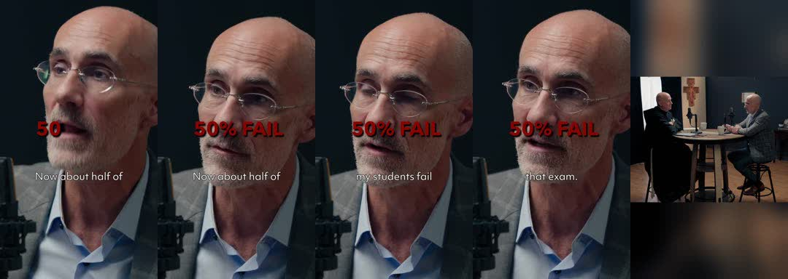

# v11_s22 · 10 Gráficas y estadística · 39.5–41.6s (calidad 4)

- **Guion:** Now about half of my students failed that exam.
- **Qué se ve:** Primer plano cerrado de Brooks (punch-in) con '50% FAIL' en rojo sobre el pecho/cuello.
- **Diseño:** Sans bold MAYÚSCULAS roja #8E1B1B, mismo estilo que '15% FAIL', a ~38–45 % de altura; caption fina debajo a ~63 %.
- **Efectos:** Sombra suave.
- **Animación:** Punch-in (corte a plano ~1.4× más cerrado) + pop del texto sincronizado con 'half'.
- **Por qué aquí:** El dato que escala la crisis: plano más cerrado + rojo = alarma.
