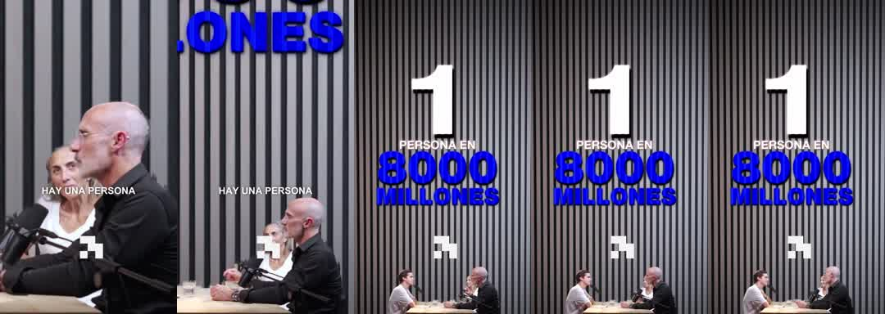

# v17_s13 · 10 Gráficas y estadística · 39.5–42.4s (calidad 5)

- **Guion:** una persona entre 8 billones de personas.
- **Qué se ve:** Plano general del set (mesa, los dos hablando pequeños abajo) con tipografía gigante: '1' blanco enorme, 'PERSONA EN', '8000' azul, 'MILLONES' azul; después todo el plano se tiñe de azul.
- **Diseño:** '1' sans heavy blanca ~30 % altura; '8000 MILLONES' azul #1A2BE0 con borde blanco ~ancho completo; bloque en mitad superior; set en el tercio inferior.
- **Efectos:** Wash/tinte azul a pantalla completa en la salida (multiply).
- **Animación:** '1' cae con pop/escala; números pop en stagger; tinte azul en ~0.3 s.
- **Por qué aquí:** Cifra impactante → tipografía gigante (animación para datos). El plano abierto da escala a la idea de 'muchas personas'.
