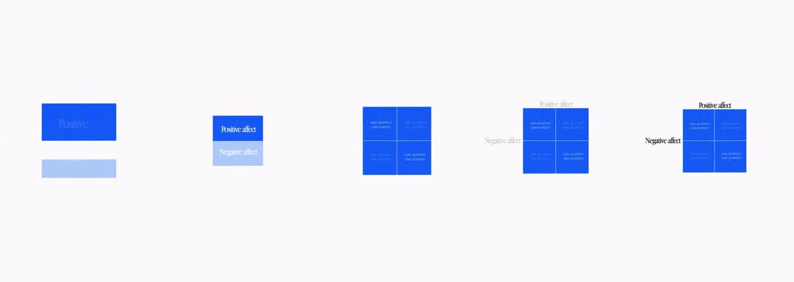

# v19_s14 · 10 Gráficas y estadística · 19.1–22.0s (calidad 4)

- **Guion:** You get two independent scores. Your positive affect and your negative affect.
- **Qué se ve:** Fondo blanco; un rectángulo azul con 'Positive affect' arriba y 'Negative affect' en azul claro abajo; se transforma en una matriz 2x2 azul con etiquetas de eje 'Positive affect' (arriba) y 'Negative affect' (izquierda), celdas con micro-texto.
- **Diseño:** Bloque azul #0A57F8, texto interior sans blanco diminuto; etiquetas de eje en serif negra pequeña. Centrado, ~35 % del ancho.
- **Efectos:** Plano, sin textura.
- **Animación:** El bloque se divide en dos y luego en cuatro (morph de forma ≈0.4 s); etiquetas aparecen con fade.
- **Por qué aquí:** Dato estructural (dos puntuaciones independientes) → diagrama. Visualiza que no es una escala sino dos ejes.
