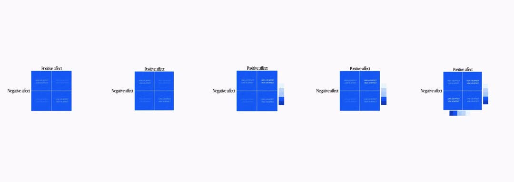

# v19_s15 · 10 Gráficas y estadística · 22.0–26.2s (calidad 3)

- **Guion:** You can run high on both. You can run low on both.
- **Qué se ve:** La matriz 2x2 se desplaza a la izquierda y aparece a la derecha una pequeña leyenda de barras con degradado azul (escala alto/bajo).
- **Diseño:** Igual paleta; barras escalonadas en tonos #1962F2 → azul claro.
- **Efectos:** Ninguno.
- **Animación:** Slide lateral de la matriz (≈0.4 s, ease-out) y barras que crecen de abajo arriba.
- **Por qué aquí:** Ejemplifica las combinaciones posibles sin cambiar de escena: continuidad para que el espectador no pierda el modelo.
