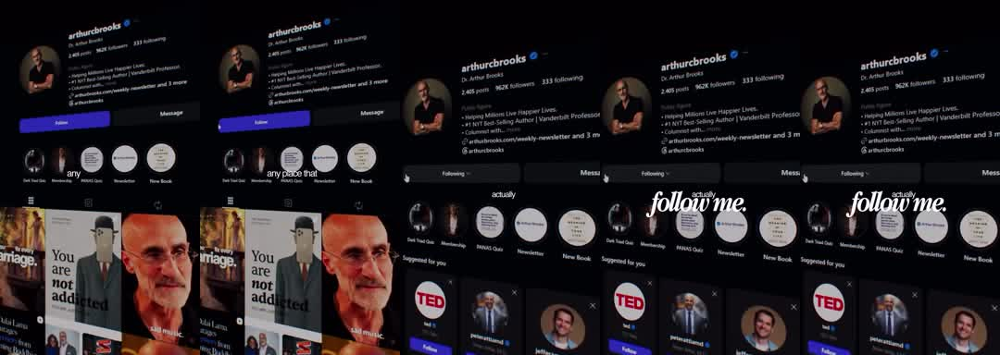

# v01_s09 · 11 UI - pantallas · 11.9–14.3s (calidad 5)

- **Guion:** any place that you actually follow me. Well,
- **Qué se ve:** Grabación de pantalla del perfil de Instagram @arthurcbrooks (modo oscuro): foto, bio, botón Follow azul, highlights, grid; un cursor hace clic en Follow que cambia a 'Following'. Caption 'any place that you' → 'actually follow me.'
- **Diseño:** UI real a pantalla casi completa, ligeramente inclinada en perspectiva; 'follow me.' serif itálica bold blanca grande al centro (~52 % alto), 'actually' sans pequeña encima a la derecha; en el primer frame 'any place that you' sans pequeña sobre el botón.
- **Efectos:** Profundidad de campo simulada (desenfoque en bordes superior/inferior), oscurecido general, cursor visible.
- **Animación:** Lento push/scroll de cámara 3D sobre la UI (≈2 s, ease-in-out); clic del cursor sincronizado con 'follow'.
- **Por qué aquí:** CTA mostrado de forma literal: la acción que pide (seguir) se ve ejecutándose.
