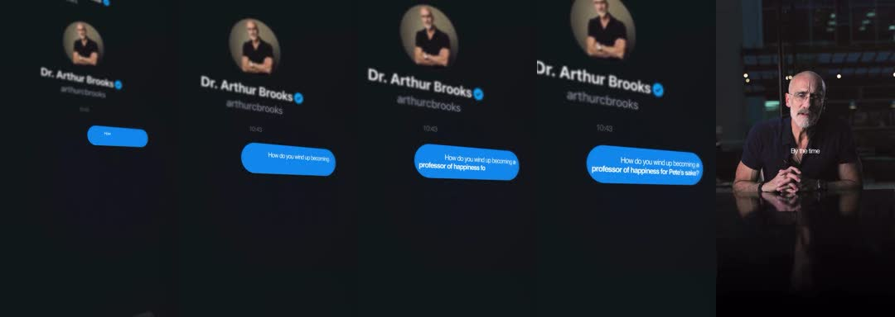

# v01_s13 · 11 UI - pantallas · 19.0–22.9s (calidad 5)

- **Guion:** How do you wind up becoming a professor of happiness for Pete's sake? By the time
- **Qué se ve:** Pantalla de mensajes directos oscura: avatar circular de Arthur, 'Dr. Arthur Brooks' con check verificado, 'arthurcbrooks'; burbuja azul que se escribe: 'How do you wind up becoming a professor of happiness for Pete's sake?'
- **Diseño:** UI de DM en perspectiva ligeramente girada; burbuja azul iMessage ~#2F7BF6 con texto blanco pequeño a ~50 % del alto, a la derecha del centro; nombre bold blanco arriba.
- **Efectos:** Profundidad de campo fuerte (todo desenfocado salvo la burbuja), fondo negro-azulado.
- **Animación:** La burbuja crece y su texto se escribe (typing) mientras la cámara hace push-in lento y rota levemente (≈3 s, suave).
- **Por qué aquí:** La pregunta de la audiencia arranca la narrativa: legitima contar la historia y engancha por curiosidad.
