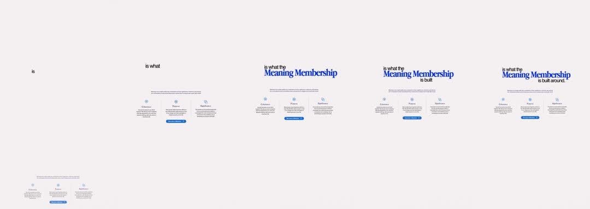

# v10_s46 · 11 UI - pantallas · 83.7–86.4s (calidad 5)

- **Guion:** is what the meaning membership is built around.
- **Qué se ve:** Fondo gris muy claro tipo web; titular 'is what the / Meaning Membership / is built around.' y debajo una sección de landing con tres columnas (iconos + 'Coherence', 'Purpose', 'Significance' + párrafos) y un botón píldora azul 'Become a Member'.
- **Diseño:** 'Meaning Membership' serif azul #1F4FD8 condensada; 'is what the' y 'is built around.' sans negra pequeña. Columnas con títulos serif pequeños y cuerpo sans diminuto; botón azul redondeado. Fondo #F2EFEF. Centrado.
- **Efectos:** Limpio, maqueta de UI plana.
- **Animación:** La UI aparece con fade/slide sutil desde abajo; el titular write-on por palabra ('Meaning' antes que 'Membership').
- **Por qué aquí:** CTA/plug del producto integrado en el argumento: la pregunta del video es la base de la membresía; se muestra la web real para que el espectador la reconozca.
