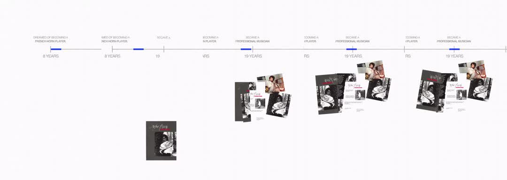

# v01_s21 · 12 Línea de tiempo · 35.7–38.2s (calidad 5)

- **Guion:** my chance when I was 19 years old. The
- **Qué se ve:** Línea de tiempo horizontal sobre papel blanco: hitos 'STOP BECOMING A HORN PLAYER' (cortado) y 'BECAME A PROFESSIONAL MUSICIAN' con '19 YEARS'; marcador azul sobre la línea; debajo un collage de fotos/portada de disco.
- **Diseño:** Línea fina gris ~#BDBDC2 a ~27 % del alto cruzando todo el ancho, ticks verticales; etiquetas en versalitas sans muy pequeñas gris oscuro con la palabra clave en bold; segmento marcador azul ~#2E4FD8. Collage de fotos ~35 % ancho centrado a ~65 % alto.
- **Efectos:** Limpio, sin textura; sombras suaves en fotos.
- **Animación:** La línea se desplaza lateralmente (slide de cámara hacia la derecha) hasta el nuevo hito y el segmento azul avanza (≈0.8 s, ease-in-out); fotos caen debajo con pop.
- **Por qué aquí:** Ordena la vida por edades: convierte la biografía en progreso medible.
