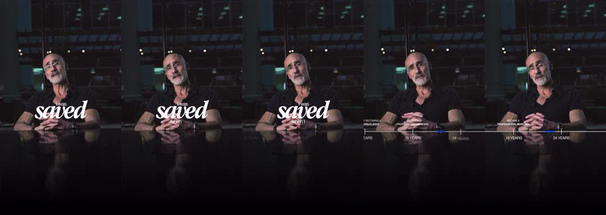

# v01_s27 · 12 Línea de tiempo · 50.5–52.3s (calidad 4)

- **Guion:** when I was 24 years
- **Qué se ve:** La línea de tiempo aparece SOBRE el A-roll, a la altura de la cintura: '19 YEARS' → '24' con marcador azul avanzando.
- **Diseño:** Misma línea fina blanca/gris semitransparente a ~54 % del alto, etiquetas versalitas diminutas, marcador azul.
- **Efectos:** Overlay sobre A-roll oscuro con ligera sombra.
- **Animación:** La línea entra con fade y desliza hacia la izquierda (≈0.8 s) para revelar el nuevo hito.
- **Por qué aquí:** Recupera el sistema de edades (continuidad) ahora sobre la cara: el hito pertenece a su vida presente.
