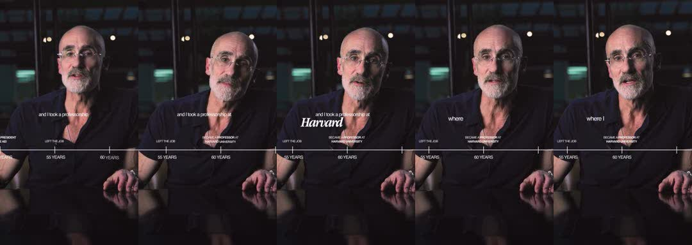

# v01_s58 · 12 Línea de tiempo · 127.3–130.3s (calidad 5)

- **Guion:** professorship at Harvard University where I teach
- **Qué se ve:** Timeline sobre el A-roll a la altura del pecho/cintura: 'LEFT THE JOB · 55 YEARS' → 'BECAME A PROFESSOR AT HARVARD UNIVERSITY · 60 YEARS'. Caption 'and I took a professorship at' / 'where'.
- **Diseño:** Línea blanca fina a ~55 % alto con ticks; etiquetas versalitas blancas diminutas con 'PROFESSOR' en bold; caption pequeño encima (~47 %).
- **Efectos:** Overlay sobre A-roll oscuro.
- **Animación:** La línea entra con fade y se desliza al hito '60 YEARS' (≈0.8 s).
- **Por qué aquí:** Último hito de la cronología, sobre su cara actual: el presente.
