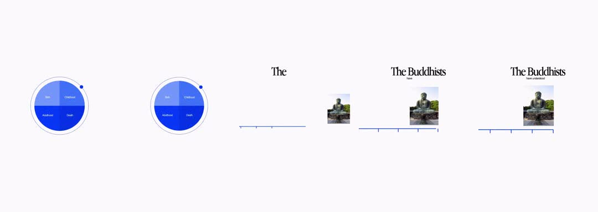

# v10_s27 · 12 Línea de tiempo · 43.0–45.5s (calidad 5)

- **Guion:** The Buddhists have understood this
- **Qué se ve:** Fondo blanco; línea de tiempo horizontal azul con marcas (ticks) que se desliza; una pequeña foto a color del Gran Buda de Kamakura en un cuadrado. 'The' y luego 'The Buddhists' grande con 'have understood' diminuto debajo.
- **Diseño:** 'The Buddhists' serif negra (menos condensada que en otras escenas) en tercio superior centro-derecha; 'have understood' sans diminuta. Línea azul 2 px con ticks verticales. Foto ~20% ancho.
- **Efectos:** Limpio; la foto mantiene color natural.
- **Animación:** La línea de tiempo entra deslizándose desde la izquierda; la foto se desplaza con ella hasta alinearse; luego zoom-in a la foto que se convierte en el siguiente plano (transición match-cut por escala).
- **Por qué aquí:** Se habla de 2.500 años: la línea de tiempo coloca el dato histórico; la foto ancla 'budistas' sin explicar.
