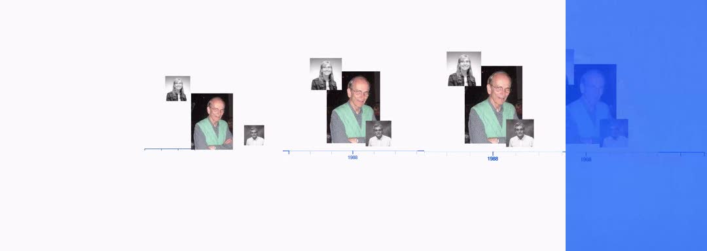

# v19_s11 · 12 Línea de tiempo · 13.8–15.4s (calidad 4)

- **Guion:** 1988 with a tool called
- **Qué se ve:** Fondo blanco con tres fotos recortadas (cutout rectangular) de los investigadores escalonadas en diagonal, y una línea de tiempo fina azul en la base con marca '1988'; luego se tiñe todo de azul claro (lavado).
- **Diseño:** Fotos rectangulares sin borde, tamaños distintos (central mayor). Línea de tiempo 1 px azul #0957F9 con ticks, año en sans diminuta. Fondo #F9F6FA → tinte azul #C5DBF9.
- **Efectos:** Fotos de archivo a color ligeramente desaturadas; overlay azul multiplicado en la salida.
- **Animación:** Fotos aparecen escalonadas (stagger ≈0.15 s) con pop; la cámara se desplaza lateralmente por la línea de tiempo; sale con wash azul (≈0.2 s).
- **Por qué aquí:** Dato concreto (año y personas) → convertirlo en algo visual y verificable aumenta credibilidad.
