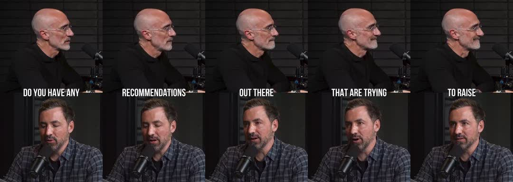

# v02_s01 · 13 Pantalla dividida · 0.0–2.9s (calidad 4)

- **Guion:** Do you have any recommendations for parents out there that are trying to raise
- **Qué se ve:** Pantalla dividida horizontal: arriba Arthur de perfil (mirando a la derecha, micrófono, fondo de listones oscuros); abajo el host (camisa de cuadros) hablando a su micro. Caption en la costura: 'RECOMMENDATIONS', 'OUT THERE', 'THAT ARE TRYING'.
- **Diseño:** Dos mitades 50/50 sin separador visible. Caption sans condensada bold MAYÚSCULAS (tipo Bebas Neue) blanca, ~4 % del alto, 1–3 palabras, centrada exactamente en la línea de división (~50 % alto).
- **Efectos:** Grade oscuro cálido, fondos negros/marrones; sombra suave tras el texto para legibilidad.
- **Animación:** Sin movimiento de cámara; captions cambian por bloques de 1–3 palabras en corte seco (≈0.4–0.8 s).
- **Por qué aquí:** Hook: la pregunta del host se ve junto a la reacción de Arthur, el espectador entiende 'entrevista' y espera la respuesta.
