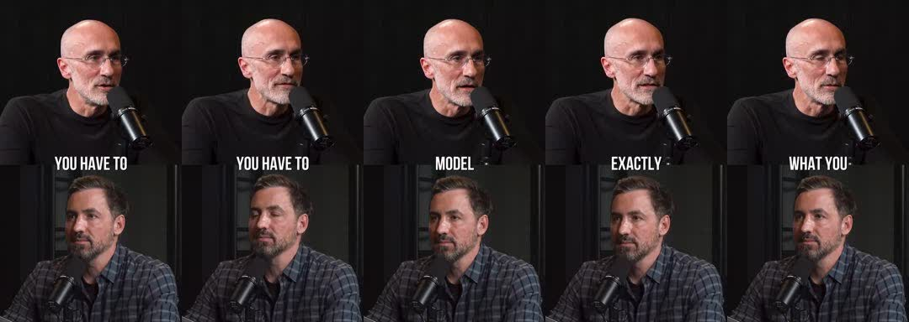

# v02_s05 · 13 Pantalla dividida · 8.4–10.0s (calidad 3)

- **Guion:** You have to model exactly what
- **Qué se ve:** Vuelve el split: Arthur arriba (plano medio) y host escuchando abajo. Caption 'EXACTLY' en la costura.
- **Diseño:** 50/50 horizontal; caption MAYÚSCULAS condensada blanca a ~50 % alto.
- **Efectos:** Grade oscuro.
- **Animación:** Corte seco a split; caption bloque.
- **Por qué aquí:** Muestra la reacción del host en la tesis ('model exactly'): valida la idea.
