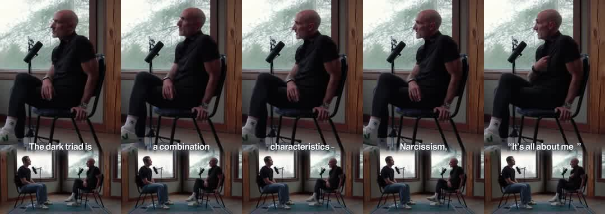

# v05_s02 · 13 Pantalla dividida · 7.9–12.7s (calidad 4)

- **Guion:** The dark triad is a combination of three personality characteristics. Narcissism, it's all about me.
- **Qué se ve:** Layout dividido: arriba (≈70 %) Arthur de cuerpo entero de perfil sentado en una silla negra frente a una ventana nevada/boscosa, micro en pie; abajo (≈30 %) plano general de los dos sentados frente a frente con ventanales. Captions 'The dark triad is', 'of three', 'Narcissism,'.
- **Diseño:** División horizontal ~70/30 sin separador; caption sans semibold blanca centrada exactamente en la costura (~68–70 % alto).
- **Efectos:** Luz de ventana difusa, tonos madera cálidos + exterior blanco-verdoso.
- **Animación:** Corte seco; ambos paneles con su propia cámara fija; captions por bloque.
- **Por qué aquí:** Definición/explicación → plano abierto 'de clase': da contexto espacial cuando enumera conceptos.
