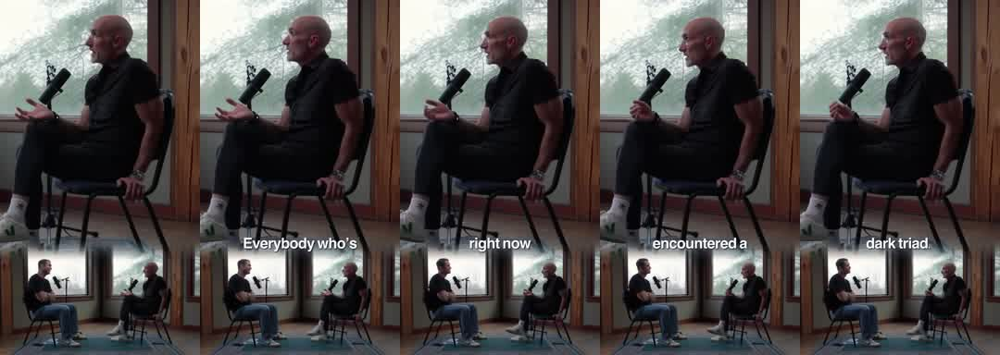

# v05_s07 · 13 Pantalla dividida · 33.1–38.5s (calidad 3)

- **Guion:** a lot. That's a lot. Everybody who's listening to us right now or watching us right now has encountered a dark triad.
- **Qué se ve:** Layout dividido 70/30 (Arthur de perfil arriba gesticulando, plano general de ambos abajo). Captions 'That's a lot', 'listening to us', 'right now', 'dark triad'.
- **Diseño:** Caption en la costura ~68–70 %.
- **Efectos:** Luz de ventana.
- **Animación:** Corte seco a split; captions bloque.
- **Por qué aquí:** Se dirige a la audiencia ('todos los que nos escuchan'): el plano abierto incluye al interlocutor = conversación.
