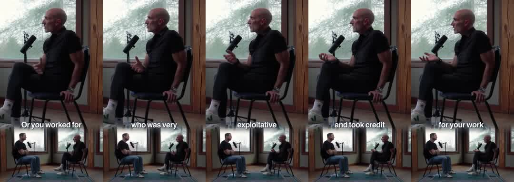

# v05_s11 · 13 Pantalla dividida · 56.9–62.9s (calidad 2)

- **Guion:** you worked for one who was very abusive and exploitative and took credit for your work.
- **Qué se ve:** Split 70/30. Captions 'one', 'who was very', 'exploitative', 'for your work'.
- **Diseño:** Caption en la costura.
- **Efectos:** Igual.
- **Animación:** Corte seco a split.
- **Por qué aquí:** Último ejemplo (jefe) en plano abierto: alterna con CU para resetear atención.
