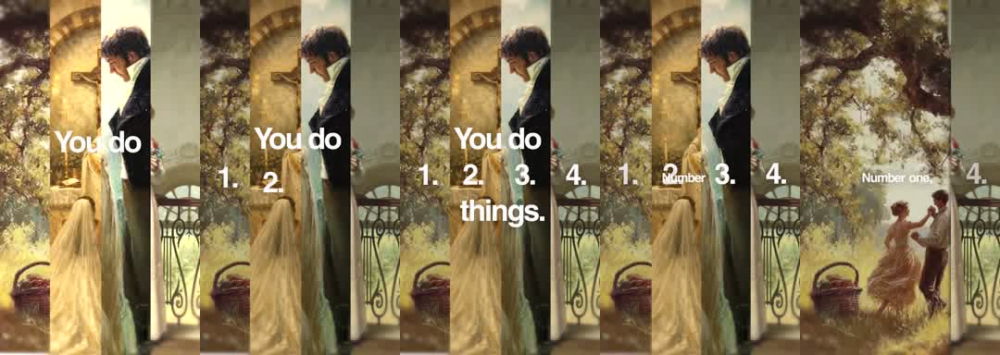

# v06_s03 · 13 Pantalla dividida · 1.2–2.6s (calidad 5)

- **Guion:** you do four things.
- **Qué se ve:** La pantalla se divide en 4 franjas verticales, cada una con una pintura distinta (altar con crucifijo, novia de espaldas, caballero, balcón). Sobre ellas: 'You do', '1. 2. 3. 4.', 'things.'
- **Diseño:** Números '1.' '2.' '3.' '4.' sans bold blanca, uno centrado sobre cada franja; 'You do' y 'things.' sans bold blanca mediana encima y debajo. Todo en la franja central de altura.
- **Efectos:** Pinturas al óleo; franjas sin separador, cortes duros.
- **Animación:** Las franjas aparecen como cortinas/barridos verticales (~0.3 s); los números aparecen uno a uno. Al pasar a 'Number one' las franjas 2–4 se retiran y la primera se expande (wipe) a pantalla completa.
- **Por qué aquí:** Anuncia una lista de 4: la pantalla dividida en 4 lo hace visible antes de explicar cada punto (estructura clara = retención).
