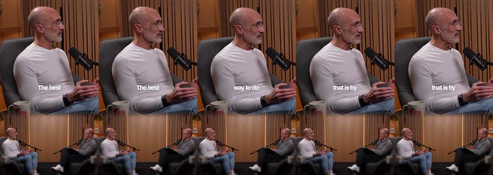

# v06_s11 · 13 Pantalla dividida · 16.1–17.4s (calidad 3)

- **Guion:** The best way to do that is by
- **Qué se ve:** Pantalla dividida horizontalmente: arriba plano medio lateral del speaker, abajo plano general de los dos (speaker y entrevistador) en el estudio.
- **Diseño:** Caption sans bold blanca pequeña en el centro de la mitad superior. Dos mitades iguales sin separador.
- **Efectos:** Ninguno.
- **Animación:** Corte seco al split y de vuelta.
- **Por qué aquí:** Variación de encuadre/contexto (es un podcast con dos personas) sin perder la cara.
