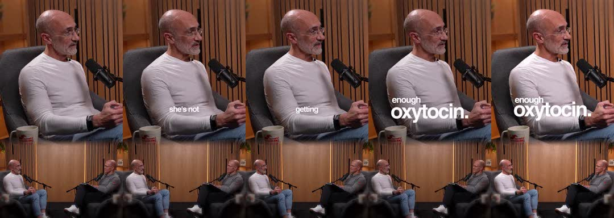

# v06_s22 · 13 Pantalla dividida · 38.3–40.2s (calidad 4)

- **Guion:** when she's not getting enough oxytocin.
- **Qué se ve:** Split horizontal: arriba speaker en plano lateral, abajo plano general de ambos.
- **Diseño:** 'enough' sans bold pequeña, 'oxytocin.' sans bold blanca grande en la mitad superior.
- **Efectos:** Ninguno.
- **Animación:** Corte seco; write-on.
- **Por qué aquí:** Cambio de perspectiva para cerrar el punto 3.
