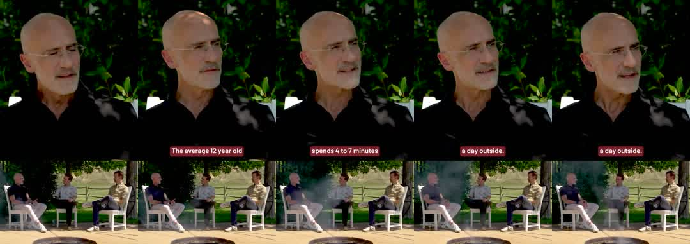

# v14_s01 · 13 Pantalla dividida · 0.0–4.0s (calidad 3)

- **Guion:** The average 12-year-old spends four to seven minutes a day outside.
- **Qué se ve:** Pantalla dividida: arriba (~65 % del alto) primer plano de Brooks en exterior con fondo de vegetación oscura, camisa negra, mirando a la izquierda; abajo (~35 %) plano general fijo de los tres (Brooks, invitado joven y otro) en sillas blancas de jardín alrededor de un brasero humeante.
- **Diseño:** División horizontal recta a ~65 % sin separador visible. Caption sans bold pequeña blanca dentro de una caja rectangular granate #7A2232 con esquinas apenas redondeadas, centrada justo encima de la línea de división (~61 % de altura), 3–5 palabras.
- **Efectos:** Luz natural dura de verano con sombras de hojas sobre la cara; humo del brasero en el plano general; sin textura añadida.
- **Animación:** Caption cambia por frase con corte seco (sin animación). Ambas mitades son vídeo continuo.
- **Por qué aquí:** Hook con dato llamativo (4–7 min al aire libre) dicho en primer plano: cara + dato. El plano general abajo da contexto de 'conversación en la naturaleza', que es la tesis.
