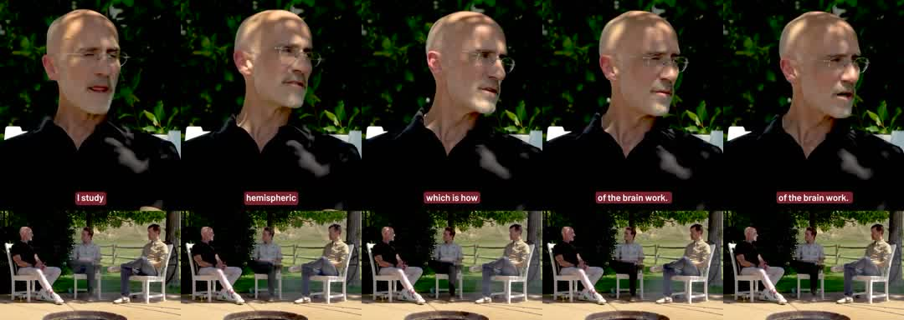

# v14_s02 · 13 Pantalla dividida · 4.0–8.9s (calidad 2)

- **Guion:** I study something called hemispheric lateralization, which is how the two halves of the brain work.
- **Qué se ve:** Arriba Brooks algo más cerrado (reencuadre/zoom), mirando a la derecha; abajo el mismo plano general.
- **Diseño:** Igual: caption en caja granate ~61 %.
- **Efectos:** Igual.
- **Animación:** Reencuadre digital (punch-in ~1.15×) a los 4.3 s.
- **Por qué aquí:** Presenta su autoridad ('estudio...'): el punch-in acompaña el término técnico.
